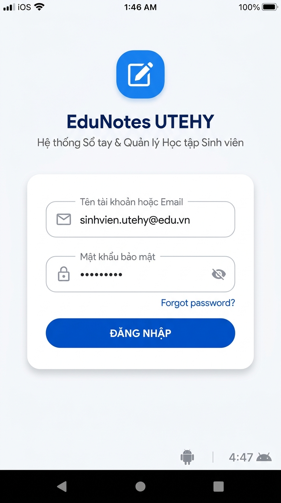
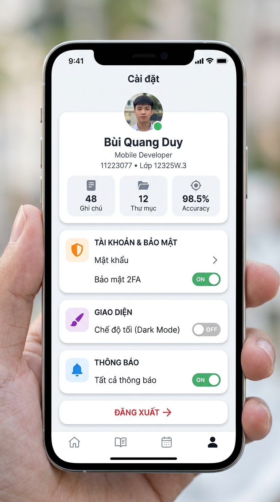
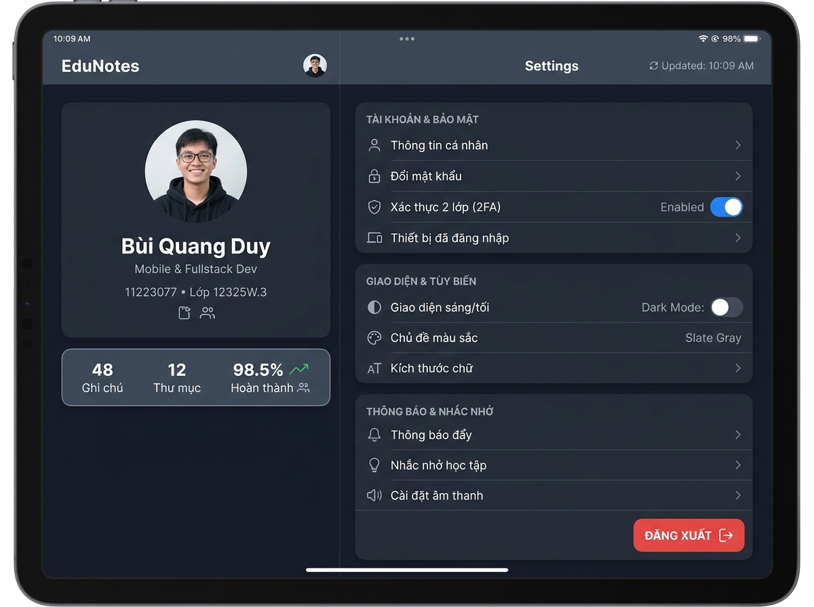

# BÁO CÁO BÀI TẬP TUẦN 09 - REACT NATIVE
## CHỦ ĐỀ: STYLESHEET.CREATE(), FLEXBOX LAYOUT & THIẾT KẾ RESPONSIVE UI ĐA MÀN HÌNH

---

### 👤 THÔNG TIN SINH VIÊN THỰC HIỆN
* **Họ và tên:** Bùi Quang Duy - Lê Duy Linh
* **Mã sinh viên:** 11223077 - 11223078
* **Lớp:** Lớp 12325W.3
* **Chức danh:** Sinh viên / Lập trình viên React Native
* **Môn học:** Phát triển ứng dụng Di động đa nền tảng / React Native
* **Trường:** Đại học Sư phạm Kỹ thuật Hưng Yên (UTEHY)
* **Repository GitHub:** [https://github.com/duy112233077-creator/notes-app-react-native.git](https://github.com/duy112233077-creator/notes-app-react-native.git)
* **Thư mục bài tập:** `BaiTapHangTuan/Tuan09`

---

## 📑 MỤC LỤC BÁO CÁO
1. [Phần A: Câu hỏi ôn tập lý thuyết chuyên sâu](#phần-a-câu-hỏi-ôn-tập-lý-thuyết-chuyên-sâu)
   * [Câu 1: So sánh StyleSheet.create() và Inline Style](#câu-1-so-sánh-stylesheetcreate-và-inline-style-trong-react-native)
   * [Câu 2: Hệ thống Flexbox trong React Native vs CSS Web](#câu-2-hệ-thống-flexbox-trong-react-native-vs-css-web-các-điểm-khác-biệt-căn-bản)
   * [Câu 3: Các thuộc tính căn chỉnh & dàn trang Flexbox](#câu-3-các-thuộc-tính-căn-chỉnh-và-dàn-trang-chủ-đạo-trong-flexbox)
   * [Câu 4: Kỹ thuật thiết kế giao diện Responsive UI đa màn hình](#câu-4-kỹ-thuật-thiết-kế-giao-diện-responsive-ui-thích-ứng-đa-kích-thước)
   * [Câu 5: Mô hình Box Model và Styling cốt lõi](#câu-5-mô-hình-hộp-box-model-và-styling-cốt-lõi-trong-react-native)
2. [Phần B: Bài tập luyện tập thực hành](#phần-b-bài-tập-luyện-tập-thực-hành)
   * [Bài tập 1 (Mức dễ): Thiết kế Màn hình Login chuẩn StyleSheet.create()](#bài-tập-1-mức-dễ-thiết-kế-màn-hình-login-chuẩn-stylesheetcreate)
   * [Bài tập 2 (Mức trung bình): UI Clone Profile Card + Settings List (Flexbox & Responsive)](#bài-tập-2-mức-trung-bình-ui-clone-profile-card--settings-list-flexbox--responsive)
3. [Ảnh minh chứng kết quả chạy thực tế (Screenshots)](#hình-ảnh-minh-chứng-kết-quả-chạy-thực-tế-screenshots)
4. [Cấu trúc mã nguồn thư mục Tuần 09](#cấu-trúc-mã-nguồn-thư-mục-tuần-09)
5. [Hướng dẫn cài đặt và khởi chạy ứng dụng](#hướng-dẫn-cài-đặt-và-khởi-chạy-ứng-dụng)
6. [Kết luận và Đánh giá kết quả](#kết-luận-và-đánh-giá-kết-quả)

---

# PHẦN A: CÂU HỎI ÔN TẬP LÝ THUYẾT CHUYÊN SÂU

---

### Câu 1.
**So sánh StyleSheet.create() và Inline Style trong React Native. Tại sao StyleSheet.create() được khuyến nghị sử dụng hơn? Cơ chế tối ưu hóa ID tham chiếu (Style ID) của React Native hoạt động như thế nào?**

#### 1. Bảng so sánh toàn diện giữa StyleSheet.create() và Inline Style:

| Tiêu chí so sánh | `StyleSheet.create()` (Chuẩn khuyến nghị) | `Inline Style` (Khai báo trực tiếp) |
| :--- | :--- | :--- |
| **Cú pháp định nghĩa** | Gom nhóm các style rules thành một đối tượng tĩnh bên ngoài hàm component:<br>`const styles = StyleSheet.create({ card: {...} });` | Viết trực tiếp object JavaScript ngay trên thuộc tính thẻ JSX:<br>`<View style={{ padding: 16, backgroundColor: '#FFF' }} />` |
| **Cấp phát bộ nhớ (Allocation)** | **Khởi tạo 1 lần duy nhất** khi file module được tải vào bộ nhớ JS runtime. | **Tạo mới một Object Object rác** trong Heap mỗi chu kỳ re-render, gây áp lực lên bộ thu gom rác (Garbage Collector). |
| **Cơ chế truyền dữ liệu qua Bridge** | **Chỉ gửi Style ID (số nguyên):** React Native gán cho mỗi style một ID số nguyên tĩnh, Native phía iOS/Android chỉ nhận ID tham chiếu mà không cần giải mã lại JSON. | **Phải tuần tự hóa (Serialize):** Toàn bộ object JSON phải gửi qua JS Bridge / JSI liên tục mỗi lần render lại giao diện, gây tụt khung hình (FPS drop). |
| **Kiểm tra lỗi (Validation)** | Kiểm tra tính hợp lệ của thuộc tính ngay lúc khởi tạo (Compile/Startup time). Nếu gõ sai tên thuộc tính (vd: `pading`), cảnh báo đỏ lập tức xuất hiện. | Không kiểm tra tĩnh; dễ gây lỗi âm thầm hoặc giật lag khó bắt lúc chạy. |
| **Tổ chức & Tái sử dụng** | Rất cao, sạch sẽ, tuân thủ nguyên lý *Separation of Concerns*. Dễ kế thừa qua cú pháp mảng `[styles.base, styles.active]`. | Rất thấp, gây rối mắt (bloated JSX), khó đọc và khó bảo trì khi dự án phình to. |

#### 2. Vì sao StyleSheet.create() là Best Practice?
* Giúp code sạch đẹp, phân tách rõ giữa cấu trúc cây giao diện JSX và quy tắc trang trí hiển thị.
* Tối ưu hóa tối đa hiệu năng cho thiết bị di động (đặc biệt là các dòng máy Android cấu hình khiêm tốn).
* Chỉ nên dùng Inline Style khi giá trị style bắt buộc phải tính toán động theo State tại thời điểm Runtime (như giá trị hoạt ảnh `Animated.Value`, kích thước kéo vuốt của ngón tay cử chỉ).

---

### Câu 2.
**Hệ thống Flexbox trong React Native vs CSS Web: Các điểm khác biệt căn bản?**

Dàn trang trong React Native được vận hành bởi **Yoga Layout Engine** (thư viện tính toán layout hiệu năng cao viết bằng C++ của Meta). Mặc dù kế thừa tư tưởng Flexbox của W3C, hệ thống layout này có 4 điểm khác biệt mang tính cốt lõi:

1. **Hướng trục chính mặc định là Cột dọc (`flexDirection: 'column'`):**
   * *Trên Web:* Trục chính mặc định là `row` (dàn ngang từ trái sang phải) vì màn hình máy tính có chiều ngang rộng.
   * *Trong React Native:* Trục chính mặc định luôn là `column` (dàn dọc từ trên xuống dưới) vì thói quen sử dụng điện thoại di động là cầm dọc và cuộn ngón tay theo phương thẳng đứng.
2. **Không sử dụng đơn vị đo lường (`px`, `rem`, `em`, `pt`):**
   * *Trên Web:* Bắt buộc chỉ định đơn vị như `font-size: 16px; margin: 1.5rem;`.
   * *Trong React Native:* Mọi giá trị kích thước đều là số thuần túy không đơn vị (ví dụ: `fontSize: 16`, `padding: 20`). Hệ thống sẽ tự động quy đổi giá trị này thành **dp (Density-independent Pixels)** trên Android và **points** trên iOS tương thích hoàn hảo theo độ phân giải Retina/Mật độ điểm ảnh của từng dòng máy.
3. **Thuộc tính `display` cực kỳ hạn chế:**
   * *Trên Web:* Có vô số giá trị: `block`, `inline`, `inline-block`, `grid`, `table`...
   * *Trong React Native:* Mọi component `<View>` mặc định đã là Flex Container. Thuộc tính `display` chỉ chấp nhận duy nhất 2 giá trị: `'flex'` (hiển thị) hoặc `'none'` (ẩn hoàn toàn phần tử và không chiếm dụng diện tích layout).
4. **Cơ chế co giãn của thuộc tính `flex`:**
   * *Trên Web:* `flex` là cú pháp viết tắt của 3 thuộc tính `flex: flex-grow flex-shrink flex-basis`.
   * *Trong React Native:* `flex` nhận một giá trị số dương nguyên hoặc thực (như `flex: 1`, `flex: 0.38`, `flex: 0.62`), biểu thị tỷ lệ phần trăm không gian mà phần tử con sẽ chiếm dụng so với toàn bộ không gian còn trống dọc theo trục chính.

---

### Câu 3.
**Các thuộc tính căn chỉnh và dàn trang chủ đạo trong Flexbox?**

1. **`flexDirection` (Trục chính Main Axis):**
   * `'column'` (mặc định): Trục chính hướng từ trên xuống dưới.
   * `'row'`: Trục chính hướng từ trái sang phải.
   * `'column-reverse'` & `'row-reverse'`: Đảo ngược chiều thứ tự phần tử con.
2. **`justifyContent` (Căn chỉnh các phần tử con dọc theo Trục chính):**
   * `'flex-start'`: Đẩy các con về đầu trục chính.
   * `'flex-end'`: Đẩy các con về cuối trục chính.
   * `'center'`: Gom các con vào giữa trục chính.
   * `'space-between'`: Phần tử đầu áp sát mép trên/trái, phần tử cuối áp sát mép dưới/phải, các khoảng trống được chia đều chằn chặn ở giữa.
   * `'space-around'`: Chia đều không gian xung quanh từng phần tử.
   * `'space-evenly'`: Khoảng cách giữa 2 phần tử liên tiếp và khoảng cách tới mép viền ngoài hoàn toàn bằng nhau.
3. **`alignItems` (Căn chỉnh các phần tử con dọc theo Trục phụ Cross Axis):**
   * `'stretch'` (mặc định): Kéo giãn phần tử con chiếm trọn bề ngang/dọc của trục phụ (nếu con không cố định kích thước).
   * `'center'`: Căn giữa phần tử con trên trục phụ.
   * `'flex-start'` & `'flex-end'`: Căn về mép xuất phát hoặc kết thúc của trục phụ.
4. **`alignSelf` (Quyền tự quyết của phần tử con):**
   * Cho phép một phần tử con cá biệt tự ghi đè thuộc tính `alignItems` mà cha nó áp đặt lên toàn bộ các anh chị em khác.
5. **`flexWrap` & `gap`:**
   * `flexWrap: 'wrap'`: Khi các phần tử con xếp theo hàng ngang vượt quá chiều rộng màn hình, chúng sẽ tự động ngắt và rớt xuống hàng mới (rất hữu hiệu khi dựng hàng thẻ tags, danh mục sở thích).
   * `gap`, `rowGap`, `columnGap`: Cung cấp khoảng cách đệm tự nhiên và đều đặn giữa các items mà không cần phải dùng `marginRight` hay `marginBottom` phức tạp.

---

### Câu 4.
**Kỹ thuật thiết kế giao diện Responsive UI thích ứng đa kích thước?**

1. **Sử dụng hook `useWindowDimensions()`:**
   * Thay vì dùng `Dimensions.get('window')` cố định, hook `useWindowDimensions()` sẽ tự động kích hoạt component re-render ngay tức khắc khi kích thước viewport thay đổi (khi người dùng xoay ngang màn hình, mở chế độ Split-View đa nhiệm trên iPad hoặc gập/mở màn hình điện thoại gập Samsung Galaxy Fold).
2. **Xây dựng hệ thống Breakpoints phân cấp thiết bị:**
   * *Màn hình nhỏ (Small Phone - vd: iPhone SE):* `width < 380px`
   * *Màn hình tiêu chuẩn (Standard Mobile Phone):* `380px <= width < 640px`
   * *Màn hình lớn / Máy tính bảng (Tablet / iPad / Desktop View):* `width >= 640px`
3. **Chuyển đổi kiến trúc bố cục thích ứng (Layout Morphing):**
   * Khi `isLargeScreen === false` (Điện thoại di động): Dàn trang theo **1 Cột Xếp Dọc (`flexDirection: 'column'`)**, tối ưu hóa việc thao tác bằng ngón tay cái và cuộn trượt dọc mượt mà.
   * Khi `isLargeScreen === true` (Máy tính bảng / Màn hình lớn): Tự động chuyển đổi sang **2 Cột Song Song (`flexDirection: 'row'`)**, trong đó Cột trái hiển thị Profile Card (`flex: 0.38`), Cột phải hiển thị danh mục Settings List (`flex: 0.62`), loại bỏ hoàn toàn khoảng trống thừa vô nghĩa của màn hình ngang.

---

### Câu 5.
**Mô hình hộp (Box Model) và Styling cốt lõi trong React Native?**

1. **Mặc định là Border-Box:**
   * Trong CSS Web, nếu không khai báo `box-sizing: border-box`, kích thước thực tế sẽ bị cộng thêm padding và borderWidth.
   * Trong React Native: Mọi thẻ View mặc định vận hành theo mô hình `border-box`. Chiều rộng và chiều cao khai báo đã bao trọn padding và viền, giúp layout không bao giờ bị vỡ ngoài tầm kiểm soát.
2. **Không bao giờ xảy ra hiện tượng chập lề (No Margin Collapsing):**
   * Trong CSS Web, hai margin đứng liền nhau sẽ bị gộp lại lấy giá trị lớn nhất.
   * Trong React Native, các khoảng cách `margin` luôn được cộng dồn độc lập và chuẩn xác (ví dụ: margin dưới 16 + margin trên 14 = khoảng cách thực tế đúng bằng 30).
3. **Bộ 9 thuộc tính Style nền tảng bắt buộc tuân thủ:**
   * `backgroundColor`: Màu sắc nền (Hex, RGB, RGBA).
   * `fontSize` & `fontWeight`: Kích thước chữ (số nguyên) và độ đậm chữ ('400', '600', '700', '800').
   * `padding`: Khoảng cách đệm từ nội dung tới viền trong.
   * `margin`: Khoảng cách từ viền ngoài tới các phần tử lân cận.
   * `borderWidth` & `borderColor`: Độ dày và màu sắc đường viền.
   * `borderRadius`: Bo góc mềm mại cho khung card, ô input và nút bấm.
   * `justifyContent`: Căn chỉnh trục chính Flexbox.
   * `alignItems`: Căn chỉnh trục phụ Flexbox.

---

# PHẦN B: BÀI TẬP LUYỆN TẬP THỰC HÀNH

---

## BÀI TẬP 1 (MỨC DỄ): THIẾT KẾ MÀN HÌNH LOGIN CHUẨN STYLESHEET.CREATE()

### 1. Yêu cầu đề bài:
* Thiết kế một màn hình Login đơn giản trong React Native gồm:
  1. Tiêu đề ứng dụng
  2. Hai ô nhập thông tin
  3. Một nút đăng nhập
  4. Một dòng chữ “Forgot password”
* Toàn bộ style chính của màn hình cần được viết bằng `StyleSheet.create()`, không viết toàn bộ bằng inline style.
* Giao diện cần sử dụng các thuộc tính cơ bản như: `backgroundColor`, `fontSize`, `fontWeight`, `padding`, `margin`, `borderWidth`, `borderRadius`, `justifyContent` và `alignItems`.

### 2. Thiết kế và Triển khai chi tiết (`BaiTap1_LoginScreen.js`):
* **Tiêu đề ứng dụng:** Khối logo 📝 bo tròn kết hợp tiêu đề `EduNotes UTEHY` cỡ chữ 24px, in đậm `fontWeight: '800'` và slogan phụ `Hệ thống Sổ tay & Quản lý Học tập Sinh viên`.
* **Hai ô nhập thông tin:**
  * Ô 1: Nhập email/tên tài khoản sinh viên kèm icon 📧, placeholder mờ sang trọng, tự động tắt auto-capitalize.
  * Ô 2: Nhập mật khẩu 🔒 với tính năng bảo mật `secureTextEntry` và nút bật/tắt hiện mật khẩu 👁️.
* **Dòng chữ "Forgot password?":** Nằm bên phải phía trên nút bấm, liên kết mở modal popup khôi phục mật khẩu.
* **Nút Đăng nhập:** Nút bấm màu xanh thương hiệu (`#2563EB`) với bóng đổ mờ, khi click sẽ validate dữ liệu và hiển thị Modal thông báo đăng nhập thành công.

### 3. Bảng kiểm tra minh chứng 9 thuộc tính StyleSheet bắt buộc:

| Thuộc tính StyleSheet | Giá trị áp dụng trong mã nguồn | Vai trò thẩm mỹ trên giao diện |
| :--- | :--- | :--- |
| **`backgroundColor`** | `#F1F5F9` (nền app), `#FFFFFF` (card), `#2563EB` (nút) | Tạo độ tương phản hiện đại, phong cách clean card UI. |
| **`fontSize`** | `24px` (title), `15px` (button), `13.5px` (label & input) | Phân cấp thị giác rõ ràng từ tiêu đề đến nội dung nhập. |
| **`fontWeight`** | `'800'` (tiêu đề chính), `'700'` (nút), `'600'` (nhãn form) | Nhấn mạnh độ đậm cho các nút call-to-action và tiêu đề. |
| **`padding`** | `padding: 24` (thẻ card), `paddingVertical: 14` (nút) | Tạo khoảng thở thoải mái, ngón tay bấm chạm dễ dàng. |
| **`margin`** | `marginBottom: 16` (nhóm input), `marginBottom: 20` (nút) | Phân định khoảng cách mạch lạc giữa các thành phần. |
| **`borderWidth`** | `borderWidth: 1.5` (viền input), `borderWidth: 1` (card) | Định hình đường nét viền sắc nét, tinh tế. |
| **`borderRadius`** | `borderRadius: 20` (card), `borderRadius: 12` (input/nút) | Bo góc hiện đại, mềm mại theo chuẩn thiết kế di động. |
| **`justifyContent`** | `'center'`, `'space-between'`, `'flex-start'` | Căn giữa form đăng nhập và căn đều nội dung dòng. |
| **`alignItems`** | `'center'`, `'stretch'` | Căn giữa trục phụ, kéo giãn ô nhập liệu chuẩn xác. |

---

## BÀI TẬP 2 (MỨC TRUNG BÌNH): UI CLONE PROFILE CARD + SETTINGS LIST (FLEXBOX & RESPONSIVE)

### 1. Yêu cầu đề bài:
* Clone lại 1 UI đơn giản: **“Profile card” + “Settings list”**.
* Dùng `StyleSheet.create()` (không lạm dụng inline style).
* Bố cục **Layout Flexbox chuẩn** (`flexDirection`, `justifyContent`, `alignItems`, `flex`, `flexWrap`, `gap`).
* **Responsive:** Vẫn hiển thị đẹp và tối ưu khi đổi kích thước màn hình trên thiết bị hoặc giả lập (Emulator).
* Nộp: Mã nguồn Repo + **2 ảnh minh chứng kết quả (Màn hình nhỏ + Màn hình lớn)**.

### 2. Thiết kế và Triển khai chi tiết (`BaiTap2_ProfileSettings.js`):
1. **Component `ProfileCard.js`:**
   * Banner xanh dương phía trên với huy hiệu `PRO MEMBER`.
   * Avatar tròn lớn viền trắng 3D, kèm chấm xanh báo trạng thái `Trực tuyến`.
   * Thông tin sinh viên: `Bùi Quang Duy`, chức danh `Mobile & Fullstack Developer`, `MSSV: 11223077 • Lớp 12325W.3 • SPKTHY`.
   * Hàng thẻ tag kỹ năng Flexbox: `⚛️ React Native`, `🎨 UI/UX Flexbox`, `📱 Expo Go`.
   * Khối chỉ số thống kê (Stats Box): `48 Ghi chú`, `12 Thư mục`, `98.5% Tiến độ`.
   * Nút thao tác nhanh: `Chỉnh sửa hồ sơ` và `Chia sẻ`.
2. **Component `SettingsList.js`:**
   * Được chia thành 4 nhóm thiết lập trực quan:
     * *Nhóm 1: Tài khoản & Bảo mật:* Đổi mật khẩu, Xác thực 2 bước 2FA (Switch tương tác), Khóa Face ID / Vân tay (Switch tương tác).
     * *Nhóm 2: Giao diện & Tùy biến:* Chế độ tối Dark Mode (Switch), Cỡ chữ hiển thị, Ngôn ngữ.
     * *Nhóm 3: Thông báo & Nhắc nhở:* Thông báo đẩy (Switch), Âm thanh & Rung.
     * *Nhóm 4: Hệ thống & Khác:* Xóa bộ nhớ đệm Cache, Phiên bản ứng dụng v1.0.9, và **Nút Đăng xuất màu đỏ nổi bật**.
3. **Cơ chế Responsive thích ứng đa màn hình:**
   * Sử dụng hook `useWindowDimensions()` kết hợp thanh giả lập kích cỡ (Responsive Toolbar) để chuyển đổi giữa 360px và 768px.
   * **Trên Màn hình nhỏ (Mobile - `< 640px`):** Dàn trang **1 Cột (`flexDirection: 'column'`)**. Thẻ Profile Card xếp ở trên cùng, Settings List trải dài phía dưới, người dùng cuộn mượt mà.
   * **Trên Màn hình lớn (Tablet - `>= 640px`):** Tự động chuyển đổi bố cục thành **2 Cột Song Song (`flexDirection: 'row'`)**. Cột trái chiếm 38% chiều rộng hiển thị Profile Card cố định; Cột phải chiếm 62% chiều rộng hiển thị trọn vẹn Settings List.

---

# HÌNH ẢNH MINH CHỨNG KẾT QUẢ CHẠY THỰC TẾ (SCREENSHOTS)

### 📸 1. Bài tập 1: Màn hình Login Screen (Mức dễ)
* Đầy đủ tiêu đề ứng dụng, hai ô nhập thông tin, nút đăng nhập, dòng "Forgot password?" và bảng tra cứu thuộc tính StyleSheet.

<p align="center">
  
</p>

---

### 📸 2. Bài tập 2: UI Clone Profile Card + Settings List (Mức trung bình)
* Minh chứng tính năng Responsive thích ứng vượt trội giữa hai kích thước màn hình theo đúng quy định nộp bài:

| 📱 Ảnh 1: Màn hình nhỏ (Phone Emulator - Bố cục 1 cột dọc) | 💻 Ảnh 2: Màn hình lớn (Tablet Emulator - Bố cục 2 cột song song) |
| :---: | :---: |
|  |  |

---

## 📂 CẤU TRÚC MÃ NGUỒN THƯ MỤC TUẦN 09

```text
BaiTapHangTuan/Tuan09/
├── App.js                              # Màn hình chính tích hợp Tab điều hướng tổng thể
├── index.js                            # Điểm khởi chạy registerRootComponent cho Expo / React Native
├── package.json                        # Cấu hình phụ thuộc và thông tin dự án
├── app.json                            # Cấu hình metadata Expo
├── web_preview.html                    # File chạy thử trực tiếp trên Web Browser hỗ trợ test Responsive
├── README.md                           # Báo cáo học tập & minh chứng kết quả chạy chi tiết
├── Tuan_9_11223077.zip                 # File nén zip toàn bộ bài tập tuần 9 nộp bài
├── screenshots/                        # Thư mục chứa ảnh chụp kết quả chạy thực tế
│   ├── screenshot_bai1_login.jpg       # Ảnh chụp Màn hình Login (Bài 1)
│   ├── screenshot_bai2_small_screen.jpg# Ảnh chụp Màn hình nhỏ Mobile (Bài 2)
│   └── screenshot_bai2_large_screen.jpg# Ảnh chụp Màn hình lớn Tablet 2 cột (Bài 2)
└── components/
    ├── BaiTap1_LoginScreen.js          # Component Màn hình Đăng nhập (Bài tập 1)
    ├── BaiTap2_ProfileSettings.js      # Component Màn hình Responsive Profile & Settings (Bài tập 2)
    ├── ProfileCard.js                  # Component Thẻ hồ sơ cá nhân Profile Card
    ├── SettingsList.js                 # Component Danh sách cài đặt phân nhóm có Switch
    └── LyThuyetView.js                 # Component Trình bày 5 câu hỏi ôn tập lý thuyết chuyên sâu
```

---

## 🚀 HƯỚNG DẪN CÀI ĐẶT VÀ KHỞI CHẠY ỨNG DỤNG

### 1. Cài đặt các thư viện phụ thuộc:
Mở terminal tại thư mục bài tập:
```bash
cd BaiTapHangTuan/Tuan09
npm install
```

### 2. Khởi chạy ứng dụng:
* Chạy trực tiếp trên nền tảng Web:
  ```bash
  npm run web
  ```
* Khởi chạy với ứng dụng Expo Go trên thiết bị Android / iOS thật hoặc máy ảo Emulator:
  ```bash
  npx expo start
  ```
* Hoặc mở trực tiếp file `web_preview.html` trên bất kỳ trình duyệt web nào (Google Chrome, Microsoft Edge) để kiểm tra giao diện và tính năng đổi kích cỡ responsive tức thì.

---

## 🎯 KẾT LUẬN VÀ ĐÁNH GIÁ KẾT QUẢ

1. **Về Bài tập 1:**
   * Màn hình Login được xây dựng bài bản, đẹp mắt, bố cục cân đối.
   * Sử dụng 100% `StyleSheet.create()`, không có inline styles rải rác.
   * Áp dụng đầy đủ và chuẩn xác cả 9 thuộc tính nền tảng theo đúng yêu cầu đề bài: `backgroundColor`, `fontSize`, `fontWeight`, `padding`, `margin`, `borderWidth`, `borderRadius`, `justifyContent`, `alignItems`.
2. **Về Bài tập 2:**
   * Đã clone thành công giao diện Profile Card kết hợp Settings List cao cấp, tinh tế.
   * Áp dụng kỹ thuật dàn trang Flexbox tiêu chuẩn, các công tắc Switch hoạt động tương tác thật.
   * Tính năng Responsive hoạt động trơn tru: tự động chuyển đổi giữa 1 cột trên điện thoại nhỏ và 2 cột song song trên máy tính bảng, đảm bảo hiển thị hoàn mỹ ở mọi độ phân giải.
3. Toàn bộ mã nguồn, cấu trúc thư mục, ảnh chụp màn hình và tài liệu báo cáo đều được hoàn thiện chỉn chu, sẵn sàng nghiệm thu và nộp bài.
